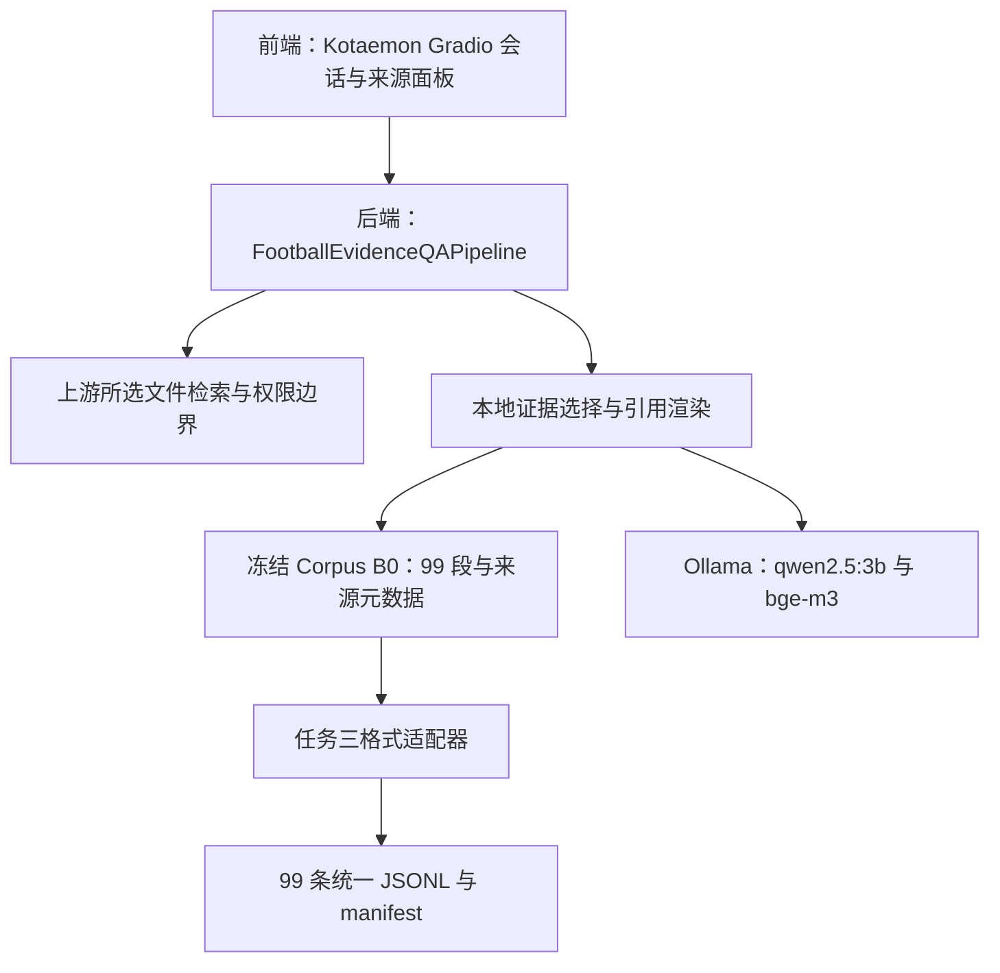

# 架构与目录映射

日期：2026-11-11。补充原技术文档，不更改其内容或任务标准。

前端与后端目前同属一个 Gradio/Python 应用，并非独立部署的两套系统。上游代码放在忽略的 `third_party/kotaemon-v0.12.0`；公开仓库只维护项目自己的启动器、证据问答覆盖层、配置和数据工具。

| 边界 | 实际实现/维护文件 |
| --- | --- |
| 页面与会话 | 固定上游 `libs/ktem/ktem/pages/`；项目 `frontend/start.ps1` 启动入口 |
| 引用面板与流式接入 | `scripts/football_quality_pipeline.py` |
| 证据范围、选择校验与答案渲染 | `scripts/football_evidence.py`、`config/answer_quality.json` |
| 兼容运行与资源准备 | `scripts/run_kotaemon_local.py`、`kotaemon_runtime_env.py`、`prepare_kotaemon_assets.py` |
| 冻结与来源审计 | `scripts/audit_task1_task2.py`、`data/manifests/task1_task2_baseline_lock.json` |
| Schema 与数据转换 | `docs/RAG_DATA_SCHEMA.md`、`scripts/build_rag_dataset.py`、`validate_rag_dataset.py` |
| 历史交付结果 | `reports/TASK_01_02_*`、`reports/TASK_03_DELIVERY.md` |

任务二 UI 的 50 个临时 chunk、质量覆盖层使用的原 99 段、任务三规范化输出是三个不同对象。任务三完成数据适配，不等于已经建好任务五/六的正式 RAG B0。

## 当前保持路径的原因

原脚本与数据 manifest 以 `scripts/`、`docs/`、`data/` 的相对路径计算版本和哈希。目录整理先增加职责说明和入口，原文件不改名、不搬移。以后若确需包结构或前后端分离，新增任务写清接口、迁移映射、兼容期和验收标准，再单独提交；不能借整理之名改动原任务要求。

## 任务六新增的实际边界

独立7863 Kotaemon App/ChatPage → rag_b0_pipeline → 问答Python子进程 → 原正式DenseIndex → 本机Qwen生成 → 程序恢复引用/完整原块。只读BaseIndex仅满足上游选择器接口，不建立第二份向量集合。数据库和日志隔离于.runtime/rag-b0，旧7860/7861/7862保持。

模型只接收规范化当前问题及一个完整原块，不使用会话历史作为事实，也不执行上传、网页读取或@WebSearch。完整正文/模型响应本机留存，公开仅配置、代码、来源元数据与验收哈希。新增代码与启动见RAG_B0.md。
