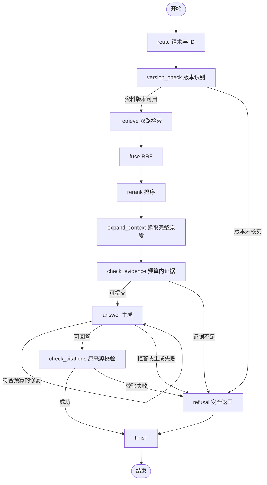

# LangGraph 足球规则问答流程

任务十七将版本短路、格式重试和引用校验放进可追踪的条件图。普通链路和图共用原语料、检索、模型和回答预算。图以独立本机入口运行，终点区分已回答、拒答和校验失败。 [交付验收](../reports/TASK_17_DELIVERY.md) · [固定配置](../config/langgraph_flow.json)

## 节点与路由



图中的检索及处理节点支持故障转到 `refusal`，具体边以编译输出为准。Dense、BM25 各取 Top80，RRF 取 k=60，BGE-Reranker 重排 Top40，保留前10个结果。上下文扩展按稳定 ID 读取完整原知识段，再在原字节预算内打包。这一对照沿用原证据范围。 [图代码](../scripts/rag_langgraph.py) · [编译的完整拓扑](../reports/task17/live-comparison.json)

版本无法核实、预算内无证据或模型判断资料不足时返回 `refused`。设备故障、重试耗尽或引用不符时返回 `failed`。模型最多提交两次，第二次仅用于可修复的结构及字段错误，并重查提示预算。传输失败和模型身份异常终止。引用必须来自已提交的段落，其 ID、来源和许可等字段逐项匹配冻结来源表。引用检查失败时返回安全消息，输出中的候选答案及引用清空。 [受控分支 trace](../reports/task17/controls.json)

每次请求获得独立 UUID。图事件带请求 ID、顺序号、节点、耗时、重试和原因。公开结果仅含状态、阶段、计时、调用计数、知识段 ID 和哈希。完整答案与引用留在本机 `.runtime/task17/traces`，图调用时使用 `recursion_limit=24`，本机入口关闭远程追踪。 [固定依赖清单](../config/task17-requirements.lock.txt) · [LangGraph 发布包](https://pypi.org/project/langgraph/1.2.22/)

## 普通链路对照

两条路径在同一独立环境、同一已初始化引擎下顺序比较，两个有推理的案例交替决定先跑哪条路径。普通链耗时含原校验过程，图耗时含图内节点和引用校验。下表每格为一个实测请求。初始化检索引擎和来源表约 6.18 s，首次导入及编译图约 1.22 s，两项均单列。首次推理的模型加载、执行顺序及实现开销可能影响单次结果。 [真实对照原始记录](../reports/task17/live-comparison.json)

| 案例 | 普通链路 | LangGraph | 实际行为 |
| --- | ---: | ---: | --- |
| 正常球门尺寸 | 24.166 s | 7.355 s | 两侧答案哈希及引用 L01-03 一致 |
| 资料外即时比分 | 6.639 s | 15.499 s | 两侧均以证据不足拒答 |
| 未核实赛季版本 | 28.552 ms | 2.523 ms | 两侧均在检索前拒答，零查询编码、重排和生成 |
| 篡改引用 | — | 7.567 s | 真实推理后在引用节点拦截，返回校验失败 |

正常及资料外每个模式每题均使用一次查询编码、40 个重排对和一次生成。普通链原可观测字段为检索、生成和总时长。图的 11 个业务节点和 22 条边带来更细的状态记录，也增加了编排代码、隔离依赖和首次编译成本。可以从 trace 区分版本短路、证据拒答、重试和来源失败。保留图作为可选入口，日常问答沿用原入口。数据只覆盖这些可复现案例，整体延迟、吞吐和回答质量变化待测。 [真实运行](../reports/task17/live-comparison.json) · [复算回执](../reports/task17/replay-public.json)

## 本机复跑和公开复验

准备任务十三的原语料、索引、BGE ONNX、固定 BGE-M3 与 Qwen2.5 3B，并在本机启动对应的 Ollama。任务十七的依赖安装到独立环境。 [任务十三准备和回滚](TASK_13_AUDIT.md)

```powershell
uv venv --python 3.10.22 .runtime/task17/venv
uv pip sync --python .runtime/task17/venv/Scripts/python.exe config/task17-requirements.lock.txt
$env:PYTHONIOENCODING = 'utf-8'
$python = '.runtime/task17/venv/Scripts/python.exe'
& $python -B scripts/run_langgraph_flow.py --question '请按这份知识库说明，球门开口通常有多宽、多高？'
& $python -B scripts/run_langgraph_flow.py --live-report reports/task17/live-new.json
& $python -B scripts/verify_langgraph_controls.py --report .tmp/task17-controls-new.json
```

最后一条使用真实图与合成依赖，覆盖重试、拒答、来源和错误状态，无模型请求。公开复验用干净的完整 Git 克隆，报告路径须在仓库内且未占用。

```powershell
python -S -B scripts/verify_langgraph_replay.py --report .tmp/task17-replay-new.json
python -S -B scripts/verify_task17_delivery.py --public-only --report .tmp/task17-delivery-new.json
```
