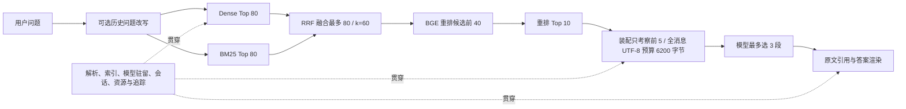

# RAG 六层调优地图与执行门禁

日期：2026-11-22。本文把当前实现、现有证据和后续实验规则放在一处。它是工作地图，不代表六层算法都已优化，也不改变已封存的历史成绩。

## 当前数据流



目前常用入口是 `frontend/start_integrated_rag_audit.ps1`（7867）与默认线性 Worker；LangGraph 是独立入口，不是默认网页路径。Parent-Child、FAISS HNSW、缓存属于各自实验/独立入口，不能当成默认链路已经启用。精确参数和源码对应由 `optimization/rag_diagnostics.py inventory` 从现行配置及代码核对。

## 六层：当前实现、指标与下一步

| 层 | 当前边界 | 主要指标 | 当前证据/优先动作 |
| --- | --- | --- | --- |
| 1 数据质量 | 来源清洗、Schema、99 个冻结知识段、正文及记录哈希、metadata | 完整性、metadata 覆盖、段长、重复正文、来源版本 | 哈希和结构完整不等于裁判专家审核或当前赛季权威性；先补经审核来源与适用版本标签，不先重切 Chunk。 |
| 2 检索召回 | Dense 与 BM25 各 Top 80，RRF Top 80，k=60；可选历史 Query 改写 | 标注证据 any-hit/all-hit、Recall、MRR；完整相关性标注后才报 nDCG | 历史22道失分题中，标注证据22/22到重排Top10、21/22进入当时Prompt；E15封存40题中可答题标注证据32/32进入Prompt。它们不证明所有问题的召回都充分，也不支持本轮盲目加Top-K/换Embedding。补充改写输入/调用计数观测，并针对真正候选缺失题再做单变量测试。 |
| 3 检索精排 | BGE-M3 检索后由 `BAAI/bge-reranker-base` FP32 ONNX CPU 重排前 40，返回 Top10 | 排序 MRR、证据到位率、成对截断 | 成对输入最多 512 token；截断记录是观测，不自动等于上下文丢失。无分级相关性标签时 nDCG 保持 pending。 |
| 4 上下文装配 | 只考察重排前 5；整段装配，完整消息 UTF-8 预算 6200 字节；最多 5 段送入模型 | 标注/人工审核支持证据是否入 Prompt、窗口/预算丢失、Prompt 字节 | 90 题中定位到 T034 一道窗口问题；不要把标注 ID 当作唯一等价证据。保留实际 Prompt 正文和哈希。 |
| 5 答案生成 | Qwen2.5:3b，最多选 3 段/最多 2 次回答调用，程序验证选择并渲染原文引用；低内存来源绑定事实路径可选 | 必要要点完整率、误拒答、正确拒答、引用逐条支持率、Schema 修复 | E15 90 题 54/72 完整、18/18 正确拒答；引用支持 75/123。一次封存 40 题 24/32、8/8、27/59，引用门禁失败。首要质量问题是选证、充分证据误拒答和无支持引用。 |
| 6 工程性能 | 7867 页面/默认 Worker；低内存模式显式启用；运行阶段观测、错误恢复与会话路径 | 技术完成、端到端延迟、可用内存、调用/重试、隔离/并发 | E15 两轮分别 90/90、40/40 技术完成，资源门槛均过；不能外推到并发、日级运行或多轮。后续单独验收会话隔离、连续长会话、并发和新增文档导入。 |

评测与观测贯穿六层。归因按**最早可观察到的失败**定位，同时保留后续问题，例如答案完整但引用无支持仍属于生成质量问题。自动报告没有人工语义审核时必须写 `pending/unknown`，不能从标签 ID、模型自报或缺失日志推断语义正确。

## 指标口径

- `annotated_any_hit@K`、`annotated_all_hit@K` 和标注证据微平均 Recall 只反映冻结标注覆盖；等价原文证据可能使金标准 ID 未命中但答案仍正确。
- `annotated_precision_proxy@K` 是“返回段中命中标注 ID 的比例”代理值，不等同于完整人工相关性 Precision。
- MRR 使用可用的标注相关段排名。没有分级相关性标注时不计算/不报告 nDCG。
- 答案完整度、拒答与引用支持分别报告。一次回答完整，不代表其每条引用都支持答案。
- 轨迹不含原始问题或 Query 改写调用明细时，调用次数和多轮状态报告为未知；不得补造。
- Graph 归档缺少完整 Worker 消息或生产者源码证明时，只标明部分轨迹范围，不冒充完整溯源验证。

## 日常调优清单

下面的清单把每个大方向拆成可以单独立项的实验。它是问题定位清单，不是要求一次性调整所有参数。每轮实验只登记一个变量，并保留同一份开发题、回归题和资源门槛。

| 大方向 | 小方向 | 关键参数或操作 | 当前状态与使用边界 |
| --- | --- | --- | --- |
| 数据层 | 文档解析 | PDF 表格、标题、跨页、OCR；检查正文、标题层级和页码映射 | 当前语料是 99 个已冻结段落，数据完整性和记录哈希已校验；没有把 OCR、表格重建或新解析器当作默认链路。只有发现原文缺失或结构损坏时才开解析实验。 |
| 数据层 | 文本切分 | Chunk Size、Overlap、语义切分、跨段边界 | 当前段长约 70–425 字符，99 段；Chunk 改动会同时改变索引、召回和引用，必须另建数据快照，不能在回答 Prompt 实验中顺手修改。 |
| 数据层 | 元数据 | 标题、章节、版本、来源 URL、来源行号、revision | 当前要求每段有来源和章节元数据，并校验正文/记录哈希；来源快照不等于专家审核或当前官方规则。 |
| 召回层 | 向量检索 | Embedding、Top-K、相似度、索引类型 | 当前 BGE-M3，Dense Top80；先按召回缺失证据归因，不能因生成错选就直接换 Embedding 或加 Top-K。 |
| 召回层 | 关键词检索 | BM25、术语匹配、分词策略 | 当前 BM25 Top80，与 Dense 通过 RRF 融合；术语、编号和专名问题可做单变量 BM25/分词实验。 |
| 召回层 | 查询优化 | Query Rewrite、Multi-Query、历史问题改写 | 当前入口可能有历史问题改写，但旧轨迹未必保存完整改写调用计数；缺少原问题或改写证据时报告 unknown，不补造调用次数。 |
| 精排层 | 结果排序 | Rerank 模型、候选数量、分数排序 | 当前 BGE Reranker，候选前40后取 Top10；先检查正确证据是否已经进入候选窗口，再决定是否改模型或窗口。 |
| 精排层 | 过滤去重 | 阈值、重复 Chunk、同源段合并 | 当前没有默认语义去重或自动冲突裁决；若做阈值/去重实验，需报告被移除段、证据覆盖和引用支持变化。 |
| 上下文层 | 证据组装 | Token/字节预算、证据顺序、最多段数 | 当前只考察重排前5，整段装配，UTF-8 消息预算6200字节，最多5段；已记录一例窗口损失。任何窗口或预算实验必须保存 Prompt 字节和段顺序。 |
| 上下文层 | 证据完整性 | 相邻块扩展、跨块合并、跨段条件检查 | 当前不自动扩展相邻段，也不做程序化冲突解决；只有证据确实跨段且召回/装配证据支持时才单独实验，不能用标签 ID替代原文审核。 |
| 生成层 | 答案约束 | Prompt、引用、拒答规则、来源绑定事实 | 当前 Qwen2.5:3b，最多选3段、最多2次回答调用；D036 缺参门禁和少量来源绑定事实路径已保留。E15 主要问题仍是选证、误拒答和无支持引用。 |
| 生成层 | 输出稳定性 | Temperature、结构化解析、重试和 Schema | 当前保留结构化输出及最多两次调用；Schema 修复属于运行观测，不自动算语义失败。若改温度或解析器，必须单独登记并保留原始响应。 |
| 工程层 | 多轮对话 | History、Session、问题改写、会话隔离 | 当前默认 Worker 和 LangGraph 是不同入口；多轮历史增长、Session 隔离和长期遗忘尚未完成独立验收，不能以单轮结果代替。 |
| 工程层 | 性能与稳定性 | 缓存、并发、超时、重试、模型驻留、增量文档 | 低内存驻留回收已通过串行资源门槛；并发、日级运行、缓存命中边界、超时恢复和增量文档摄取仍需专项。模型驻留策略必须同时看可用内存、延迟和重载次数。 |

### 使用顺序

先根据错误最早发生的层选择一行，再登记一个变量和停止条件。数据损坏先修数据；候选中缺少必要段才看召回；正确段在候选中但排序靠后才看精排；正确段未进入 Prompt 才看上下文；证据已在 Prompt 仍误选、误拒答或引用不支持才看生成；前五层通过后再评估会话、并发和长期运行。

每项实验都要记录：修改前后值、问题子集、独立重复次数、实际 Prompt/选段、答案要点、引用支持、耗时、可用内存和回归结果。只有在专项和固定回归都通过后，才考虑保留该变量变化。

## 初始实验面板

下面是中文文档知识库可以用来起步的候选范围，不是当前生产配置，也不是通用最佳值。登记后仍需通过实验计划门禁，实际生效要经过专项和固定回归。

| 参数 | 起始候选 | 建议对照范围 | 当前实际值 | 是否需要重建索引 |
| --- | --- | --- | --- | --- |
| Chunk Size | 500 tokens | 300 / 500 / 800 tokens | 当前为冻结的 99 个段落，字符长度约 70–425；没有统一 token Chunk Size | 是 |
| Chunk Overlap | 80 tokens | 0 / 40 / 80 tokens | 当前冻结语料不做本轮重切分 | 是 |
| 向量 Top-K | 10 条 | 5 / 10 / 20 条 | Dense 与 BM25 各 80，RRF 融合最多 80 | 否，但必须重新记录候选规模和资源 |
| Rerank 保留数 | 5 条 | 3 / 5 / 10 条 | BGE 重排候选前 40，输出 Top10；上下文实际考察前5 | 否；需要区分重排输出 Top-K 和上下文窗口 |

### 如何解释这组起始值

`500 tokens + 80 tokens overlap` 适合作为切分实验的起点，但不能直接套到当前冻结语料。改变 Chunk Size 或 Overlap 会改变段 ID、正文边界、索引和引用映射，必须生成新的数据快照并重新建立 Dense/BM25 索引；原 90 题结果只能作为历史对照。

Top-K 和 Rerank 数值通常可以复用当前索引。建议先做 `Top-K 5 / 10 / 20` 的单变量对照，再决定是否改变 Rerank 保留数。候选数必须始终不小于保留数，并分别报告：候选召回、重排命中、进入 Prompt 的证据、引用支持、延迟和内存。Rerank 保留数增加不代表答案一定更好，可能把无支持段带入模型。

因此，当前不把面板中的 500、80、10、5 写入默认配置。它们是后续实验登记值；实际变更要绑定冻结快照、开发题、固定 90 题回归和新的未见验收集。

## 每轮调优流程

1. 运行 `inventory` 检查当前参数、入口和配置/代码是否一致；记录运行时服务是否另行核实。
2. 将改动落在独立分支。提交代码后执行 `freeze`，得到提交绑定的基线快照；固定语料、问题集、模型、Prompt、索引和运行配置。
3. 写一个实验计划：一个变量、明确的前后值、可证伪假设、独立问题数、重复次数、通过条件、资源上限、停止条件和允许修改文件。计划必须绑定快照 identity。
4. 只用 `dev40` 选方案。`regression50` 用作固定 90 题回归，不作为调参集；已使用的 `exposed40` 是暴露验收集，不能再次声称 unseen。
5. 先跑小专项，再跑同期 A/B 和固定 90 题回归。逐题保留首答、状态、选段、引用、阶段耗时和资源低点；不删除退化样本。
6. 新候选必须有独立的未见验收集。当前没有可用的新集；需要另行采集并经审核，不能把已有 exposed40 改名重用。
7. 只有质量、引用、拒答、技术与资源门槛均通过，且逐题退化审查完成，才讨论发布；本工具不会自动合并或修改默认入口。

当前 E15 的固定 90 门槛为：90/90 技术完成、54/72 完整可答、18/18 正确拒答、引用支持不少于 75/123、每请求不超过 60 秒且最低可用内存不低于 1 GiB。新最终集、留出集与专项另列，不混入该分母。

## 离线诊断命令

在仓库根目录使用项目固定 Python。输出路径必须是新路径，工具不会覆盖既有结果：

```powershell
$py = ".runtime/task13/venv-final/Scripts/python.exe"
& $py -B optimization/rag_diagnostics.py inventory --profile low_memory_facts --out .runtime/six-layer/inventory.json
& $py -B optimization/rag_diagnostics.py audit --suite e15_90 --suite e15_40 --out .runtime/six-layer/audit.json
& $py -B optimization/rag_diagnostics.py case --trace <private-trace.json> --dataset dev40 --qid <question-id> --out .runtime/six-layer/case.json
```

`freeze` 需要先把工具和策略提交到当前分支；之后用新输出路径冻结已提交版本。再以快照中的 `snapshot_identity` 填写 `optimization/governance/experiment_template.json` 的副本，运行 `check-plan`。工具不启动服务、不构造索引、不调用模型；`verify_six_layer_governance.py` 检查诊断分类、计划门禁和篡改样本。

逐题语义审核须将 review 绑定到题目哈希、轨迹哈希、完整要点、必要条件和引用段。审核模板只是记录格式，不是独立人工签收凭证。`case --show-content` 会把私有问题、Prompt、原始响应和正文写入输出，不要将这种输出提交或公开。

## 本轮边界

本轮增加的是六层清单、配置/源码一致性核验、冻结快照、逐层轨迹归因、审核模板和实验计划门禁；用历史 90+40 共 130 份轨迹做零新增推理复算。它没有改变检索参数、Embedding、重排器、切分、Prompt 或模型，也没有修复 E15 的回答/引用质量问题。E15 的 40 题引用门禁仍失败；会话/并发/长期记忆/增量文档和新未见验收集仍待专项验证。
