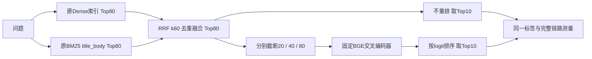

# BGE-Reranker候选截断实验（原任务十）

原技术文档5.3与原执行任务10未改。执行协议见[TASK_10_SCOPE](TASK_10_SCOPE.md)，完整结果见[reranker_results](../reports/reranker_results.json)，交付映射见[TASK_10_DELIVERY](../reports/TASK_10_DELIVERY.md)。

## 1. 这一步做什么



Dense、BM25、RRF原参数与99段语料不变。任务九每路10的候选深度不足以测试80，所以本轮使用独立配置将两路都实际检索到80，RRF保留80。四个方法各自执行一次完整链路；对照是本轮不重排，不能将任务九不同候选深度的历史指标混入本轮增益。

## 2. 模型、设备、token与计时

- [BAAI官方模型卡](https://huggingface.co/BAAI/bge-reranker-base)：中文/英文交叉编码器，输出未归一化logit，高分优先，不是概率。
- 固定revision `2cfc18c9415c912f9d8155881c133215df768a70`；官方FP32 ONNX、CPUExecutionProvider、8线程、batch8；没有量化、训练或远程推理。权重1,112,459,588字节，SHA-256 `15b9a8c3da82eddf263df571281166e00e9308fe19d077084b642ebfcaf06d2b`。五份模型/分词配置逐项核验，现有核心依赖不变。
- ONNX输入`input_ids`/`attention_mask`；tokenizers0.22.1、onnxruntime1.19.2、numpy1.26.4。query按原规范化，passage为原标题路径与正文；pair最长512，longest_first右截断、动态右padding。公开每个pair输入ID哈希、原token数、使用数及截断数，不公开passage。
- 运行前记录Python3.10.22、CPU/内存、包、模型/索引身份、加载时间；每个方案各用非评测问题实际预热3次。并发1、无应用结果缓存，每题方法顺序循环轮转，各测一次。质量dev32题/test40题；延迟覆盖dev40题/test50题。
- 原始计时单位秒，表格毫秒。完整链路从query规范化开始到Top10适配结束，包括Dense/BM25/RRF与可选重排；重排包括pair构建、原长度统计、分词/张量、各batch推理与排序/适配。加载、预热、JSON写盘和离线打分单列并排除。原始packet含分阶段时间、每batch形状/时间及Embedding服务计数；不用历史耗时相加。
- 这是普通桌面CPU的一轮描述统计。P50/P95线性插值，样本40/50，不代表生产SLA、并发吞吐或显著性检验。nDCG@10=null：无分级标签。检索命中不等于答案/引用/拒答正确率。

## 3. 开发选择与冻结

首次实现`8ac34d6`提交后真实dev矩阵完成，再补强源代码/审核凭证/索引前后快照绑定和整数溢出拒绝，不修改模型参数或排名结果。专项74/74及公开开发复算29/29完成后，在 `f6be8bd5252da48eb5c9253de7ddde7108e88643` 冻结源码、配置、开发证据和选择，签发任务十授权，独占预约一次正式test矩阵。

按预声明的MRR、Recall@5、Recall@10、总链路P50、方法顺序选择：**top40**。Top40和Top80开发质量相同，Top40耗时更低；Top20在开发集丢失一题支持候选。这个选择发生在本轮test之前。测试是任务7–9已经使用过的锁定50题，不能称新未见holdout。test只报告，不重新选择方案。

### 开发（32/40可回答）

| 方案 | Recall@5 | Recall@10 | MRR@10 | 重排P50/P95 ms | 完整链路P50/P95 ms |
| --- | --- | --- | --- | --- | --- |
| no_rerank | 96.875% | 96.875% | 0.916667 | 0.00/0.00 | 296.50/348.83 |
| top20 | 96.875% | 96.875% | 0.916667 | 2602.98/3201.45 | 2890.19/3517.84 |
| top40 | 100.000% | 100.000% | 0.947917 | 5467.95/6020.49 | 5782.43/6356.33 |
| top80 | 100.000% | 100.000% | 0.947917 | 10503.34/11122.34 | 10778.18/11503.38 |

### 锁定测试（40/50可回答）

| 方案 | Recall@5 | Recall@10 | MRR@10 | 重排P50/P95 ms | 完整链路P50/P95 ms |
| --- | --- | --- | --- | --- | --- |
| no_rerank | 97.500% | 100.000% | 0.936458 | 0.00/0.00 | 358.42/397.62 |
| top20 | 100.000% | 100.000% | 0.975000 | 3206.33/3942.71 | 3566.06/4281.08 |
| top40 | 100.000% | 100.000% | 0.975000 | 6607.19/7335.27 | 6949.91/7696.76 |
| top80 | 100.000% | 100.000% | 0.975000 | 13021.14/13798.49 | 13363.95/14163.51 |

所选方案的多支持平均覆盖率`all_gold_coverage@5`为98.125%，未全覆盖题为T022=75.0%、T034=50.0%。Recall100%表示每题至少一个标注支持命中；全部支持段的前后名次与是否因前缀排除在`rank_changes.json`逐项列出，不能据此宣称每题证据或答案全部正确。

开发选中的top40，test相对同条件不重排：R@5差 +2.500个百分点，R@10差 +0.000个百分点，MRR差 +0.038542。Top40相对Top80的重排P50观察下降49.26%，完整链路/召回差见JSON；这是本机样本，不能改写成简历示例中的400→120ms或70%。

## 4. 截断与错误案例

| 集合/方法 | Top5未命中 | Top10未命中 | 候选无正确证据 | 相对80因截断丢失全部正确证据 | MRR变差题数 |
| --- | --- | --- | --- | --- | --- |
| dev/no_rerank | 1 | 1 | 0 | 0 | 0 |
| dev/top20 | 1 | 1 | 1 | 1 | 1 |
| dev/top40 | 0 | 0 | 0 | 0 | 1 |
| dev/top80 | 0 | 0 | 0 | 0 | 1 |
| test/no_rerank | 1 | 0 | 0 | 0 | 0 |
| test/top20 | 0 | 0 | 0 | 0 | 1 |
| test/top40 | 0 | 0 | 0 | 0 | 1 |
| test/top80 | 0 | 0 | 0 | 0 | 1 |

“候选无正确证据”包括在完整80里也找不到的题；“因截断丢失全部”仅指80里存在、该前缀完全没有。丢失部分支持ID另见错误案例`gold_excluded_by_prefix`与全部题的`rank_changes.json`中`labelled_support_rank_changes`，不与题级any-hit混算。候选仍有支持但排序跌出前10与召回阶段缺证据分开；MRR变差即使Recall命中也保留。

- D001：人工草坪的颜色有什么限制？ 支持ID L01-01。no_rerank：24→24；top20：24→None；top40：24→1；top80：24→1。这里的None表示不在该候选范围，指标仍只看前5/10。
- D011：球碰到裁判后出现哪三类后果，会导致球不再处于比赛中？ 支持ID L09-01。no_rerank：1→1；top20：1→2；top40：1→2；top80：1→2。这里的None表示不在该候选范围，指标仍只看前5/10。

逐题人工易读版本：[dev/rank_changes](../reports/retrieval/bge_reranker_b0/dev/rank_changes.json)、[test/rank_changes](../reports/retrieval/bge_reranker_b0/test/rank_changes.json)。完整前80/后20/40/80及logit、原双路排名/分数/批次/计时在各`predictions.jsonl`，所有实际错误在`error_analysis.json`。模型token截断数量也在summary，不能把“候选截断”混作“正文省token”。不根据test案例修改本轮参数。

## 5. 交付复审：冷启动修复

正式测试保持原冻结提交和原字节。复审通过模拟空模型驻留状态，复现原环境采集在预热前失败的依赖（10/10模拟复现）。交付版将环境采集移动到12次预热结束、正式测量开始之前，并修复不重排Top10与before80共享字典的返回别名（修改Top10会污染前排名，已由隔离检查实际复现）；模型、候选、评分、计时边界及选择规则不变。表格对应冻结提交的原实测，不冒充修复后的重新计时，不重跑正式test。

当前代码专项74/74、启动/异常记账回归12/12通过；另起独立Ollama端口和独立进程，确认初始无驻留模型，一次非评测查询后成功采集固定CPU运行时，实际冷启动8/8。该示例多1次Embedding、0重排pair/答案/锁定测试请求，单列记录，不进原评测分母。只停止新建进程，原服务不动。最终公开35/35包含这些回执复算，原正式授权仍校验其原冻结源码。

## 6. 运行与复算

在已按PUBLIC_SETUP恢复原61份本地快照和固定核心环境、原Dense/BM25索引、本地Ollama服务的仓库中：

```powershell
.venv/Scripts/python.exe -B scripts/install_reranker_model.py --download
.venv/Scripts/python.exe -B scripts/run_reranker_experiment.py query --question "请查找球场球门的规定尺寸资料。" --method top40
# 新开发目录，禁止覆盖已有证据；CPU一轮需要十多分钟
.venv/Scripts/python.exe -B scripts/run_reranker_experiment.py dev --run-dir reports/retrieval/my-reranker-dev-001
```

已下载可不加`--download`只验SHA。模型主站超时后使用固定HF镜像传输权重/分词器、小配置取BAAI固定ModelScope版本；下载结果需通过官方固定LFS SHA/Git blob身份核验。首次网络下载/加载不计入查询延迟；权重与全文不上传Git。下载失败保留`.partial`证据，不自动覆盖或混入部分下载。

只有公开代码也可复算，无需任何模型、语料、索引或第三方包：

```powershell
python -S -B scripts/run_reranker_experiment.py replay --run-dir reports/retrieval/bge_reranker_b0/dev
python -S -B scripts/run_reranker_experiment.py replay --run-dir reports/retrieval/bge_reranker_b0/test
```

复算可验证RRF、前缀预算、logit排序、指标、错误计数、耗时统计和Git/原索引身份，不能凭公开元数据重新推导私有正文的token或模型logit。正式test授权和STARTED/COMPLETED账本已消耗，入口会拒绝第二次正式test；后续研究需另建实验ID、授权和账本，不得删除旧记录。

任务十提供独立CLI与检索适配层。任务六网页仍使用原Dense B0。下一项按原计划执行任务十一，不把本轮检索成绩当成网页答案质量提升。
