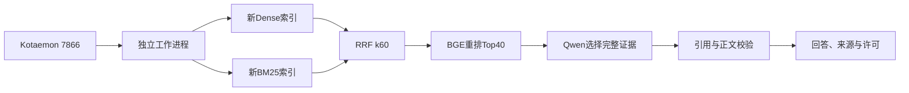

# 任务十三：安装、导入、重建、运行与复验

本页是当前集成版的操作入口。原技术设计/执行标准和历史实验不改。实际本机记录见 `reports/task13`，最终交付见 `reports/TASK_13_DELIVERY.md`。

## 1. 当前结构和前提



- 本轮实测Windows、Python3.10.22、CPU8；新环境 `.runtime/task13/venv-final`，新数据库 `.runtime/task13/kotaemon`。
- 需要Git完整历史、固定上游 `9ad3e4e49aa35b8acddd235918a5d9753c1cfdf9`、本机Corpus B0存档、固定模型和足够磁盘/内存。
- 新Python环境实际从空目录安装，模型、上游源码及校验过的缓存复用现有本机资源。没有声明下载了全新的模型，也没有跨操作系统兼容验收。
- 公共仓库没有规则全文和权重；从GitHub克隆代码后，必须另行准备自己的语料存档和模型，不能靠公开元数据还原原文。

## 2. 取得固定代码与上游

```powershell
git clone https://github.com/yangyanbeen/football-rules-rag-lab.git
Set-Location football-rules-rag-lab
# 发布后可检出 v0.13.0-integrated-delivery
git clone --branch v0.12.0 --depth 1 https://github.com/Cinnamon/kotaemon.git third_party/kotaemon-v0.12.0
git -C third_party/kotaemon-v0.12.0 rev-parse HEAD
```

最后一条必须得到固定上游提交。不要用上游main替换。`docs/UPSTREAM_VERSION.md`保留上游来源与许可说明。

准备uv和Python3.10.22独立解释器；可以使用已有可信安装，将其绝对路径传给下一步。若用uv下载解释器，可先执行 `uv python install 3.10.22 --install-dir .runtime/python`，再找到该目录实际的python.exe路径。脚本会核对实际版本，不依赖目录名字猜版本。

## 3. 安装独立运行环境

```powershell
# 示例路径按自己的安装位置填写，输出环境必须是新目录
python -B scripts/prepare_task13_environment.py --uv C:/tools/uv.exe --python C:/tools/python31022/python.exe --report reports/task13/environment-new.json
```

本机已准备路径时可直接使用默认参数；缓存齐全可增加`--offline`。固定依赖文件为 `infra/task13-runtime-requirements.txt`，安装强制校验hash，不解析浮动最新版。其内容与固定上游uv.lock离线重新导出的文件逐字一致，依据见 `requirements-provenance.json`。随后仅安装固定上游的两个本地源码包，不安装图检索/训练等可选extras。

实际新环境安装260项锁定依赖和2个源码包，共262项。原.venv不改。首次沙箱安装曾在系统临时目录构建editable wheel失败；当前安装器把TEMP/TMP放到项目.runtime/task13下，失败目录和回执保留，重试用另一个全新环境完成。不要通过删除旧环境掩盖失败。

## 4. 导入既有语料

将原项目或备份目录作为source-root，它应保留 `data/raw`、`data/processed` 等相对路径：

```powershell
.runtime/task13/venv-final/Scripts/python.exe -B scripts/task13_resources.py import --source-root C:/path/to/your-corpus-backup --report reports/task13/import-new.json
```

导入器先核对61份文件的大小/SHA，再复制缺失文件；已有相同文件只校验，已有不同文件直接拒绝，不覆盖、不重译、不二次切分。两份适配JSONL及5份中文资料的来源/稳定ID保持。报告应显示99个知识段。干净公开副本从无data/processed状态复制61份文件的实际证据见 `clean-corpus-import.json`。

若只有原始Corpus B0而没有任务3适配JSONL，按 `docs/RAG_DATA_SCHEMA.md` 使用 `build_rag_dataset.py` 在新派生路径生成后，先与 `local_data_files.json` 的固定哈希核对；不能把应用上传后自行切分的数据冒充这批99段。

## 5. 准备和核对本机模型

需要Ollama0.40.16在127.0.0.1:11434运行，以及下列固定模型：

| 资源 | 固定身份 |
| --- | --- |
| qwen2.5:3b | digest见config/answer_evaluation.json，357c53fb…c9e4b；ctx8192、predict1024、CPU8、temperature0、seed42 |
| bge-m3:latest | digest见config/dense_index.json，79076464…6bab；1024维、CPU8，不截断输入 |
| BGE-reranker-base | revision2cfc18c9415c912f9d8155881c133215df768a70，FP32 ONNX；5文件SHA见reranker_experiment.json |

模型名称中的latest不是运行时漂移许可，完整digest必须一致。可复用自己已核验的模型存档与本机服务；不要只因浮动tag相同就认定是相同模型。没有对应固定模型时先准备模型，再运行预检查；脚本不会静默改用别的模型。

重排资源可使用已有 `install_reranker_model.py --download` 获取固定文件并逐文件核验。BM25资源使用 `install_bm25_runtime.py`，其jieba0.42.1归档和词典都有固定hash；使用者可先查看脚本帮助。UI辅助资源通过 `prepare_kotaemon_assets.py` 准备，已有缓存优先校验复用。完整许可分别见 `TASK_13_LICENSES.md`。

```powershell
.runtime/task13/venv-final/Scripts/python.exe -B scripts/task13_resources.py preflight --report reports/task13/preflight-new.json
```

预检查核对语料、上游、262项环境、模型身份、ONNX资产和UI资源，不生成答案。实际模型复用路径与服务是本机运行条件，不会写入账号或云API密钥。

## 6. 重建新索引

```powershell
.runtime/task13/venv-final/Scripts/python.exe -B scripts/task13_resources.py rebuild --report reports/task13/rebuild-new.json
```

默认创建 `data/indexes/task13/dense-v1` 和 `data/indexes/bm25/task13-title-body-v1`，已有目录一律拒绝，不覆盖旧索引。再次重建时，先把 `config/task13_app.json` 两个目录改为新的task13版本路径，并作为新配置提交；已有演示和版本保持。

Dense实际重新编码99段，并保留向量指纹、批次、时间、ID映射和Chroma内容；BM25从同一99段重建title_body词项，保留TF/DF、来源和生产提交。工作进程实际打开这些新索引，旧25个索引文件另核验不变。旧task5/8单独构建入口仍保留历史用途。

## 7. 启动、提问和关闭

```powershell
powershell -ExecutionPolicy Bypass -File frontend/start_integrated_rag.ps1
```

打开 http://127.0.0.1:7866/ 。无需注册新账号。只支持固定语料文字提问，上传和外部检索不在本入口中。每次回答在独立进程运行，避免Windows UI与原生索引共进程问题；失败不会显示为成功的足球规则答案。

答案引用使用本地编目号，不宣称它就是官方条号。来源面板提供完整原段、URL、行号、署名/许可和校核提示；统一说明非官方赛季规则、非专家审校、历史修订未独立核验。对话历史不作为新的事实证据。

在启动终端按Ctrl+C关闭7866。Ollama若由你单独启动，应在它自己的终端关闭；不要终止不属于本项目的服务。原7863 B0和7865人工审核的数据不与新数据库合并。

## 8. 演示和评测复算

```powershell
.runtime/task13/venv-final/Scripts/python.exe -B scripts/run_task13_demo.py --report reports/task13/demo-new.json
.runtime/task13/venv-final/Scripts/python.exe -B scripts/verify_task13_contract.py --private --report reports/task13/contract-new.json
```

演示包含正常回答、越位条件/例外、资料外拒答、可回链引用和官方版本拒答。它是新功能冒烟，不是正式准确率样本。完整答案/请求/原响应仅在.runtime/task13；公共回执提供SHA、来源元数据、实际尝试和阶段时间。

历史正式dev/test与账本已封存，只读复算，不删除目录重测：

```powershell
python -S -B scripts/run_answer_evaluation.py replay
# 当前任务13完整验收（公开副本加--public-only，报告用新路径）
python -S -B scripts/verify_task13_delivery.py --public-only --report reports/task13/recheck-public-new.json
```

完整Git历史用于核对生产提交。公开复算不需要模型或全文，不能重新证明私有推理内容，只能复算脱敏投影/哈希和已保存回执；私有记录一致性由本机门禁另验。

## 9. 版本、清单、限制与回滚

全局 `data/manifests/project_file_manifest.json` 覆盖最终公开文件及61份本地资料的仅哈希条目，自身不递归。`reports/task13/delivery_manifest.json` 是本轮运行包的固定输入/代码/模型/报告清单，排除最后追加的递归清单和交付说明，并写明生产提交。每条实验记录可回链实际命令和原始结果。

当前集成保留任务12的保守摘录方案，会冗长、误选无关段或错误拒答。其既有人审引用9/20等结果保留；本轮5类演示不证明整体质量提升，没有新QPS、生产SLA或跨平台数据。Docker未纳入本机验收；原规定允许选择不提供Docker。

需要回滚时，创建独立checkout检出先前标签（例如v0.12.2-task12-acceptance）；不要重置当前带改动的工作区，不删除正式账本或覆盖现有索引。新版本的配置、索引和数据库采用不同目录保留，原项目和其他GitHub仓库不改。
